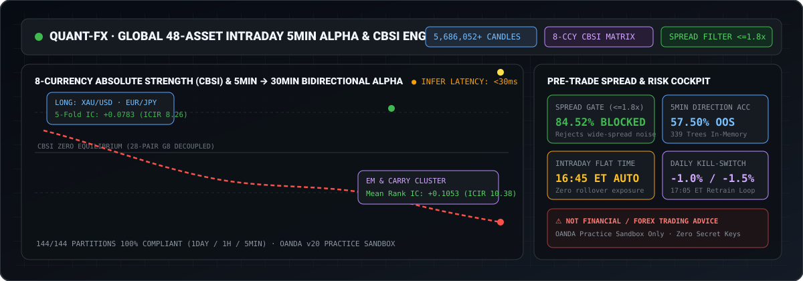
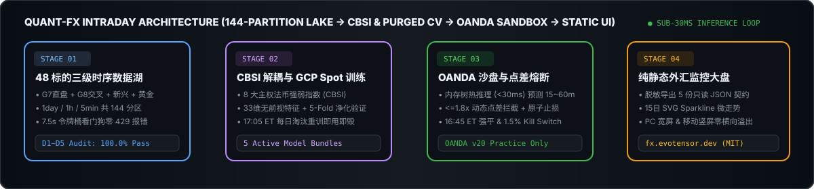

# 💱 Quant-FX-UI · 全球外汇与贵金属量化监控大盘

**纯静态零构建 PWA 外汇投研看板 · 覆盖 48 标的 144 分区数据湖、八币 CBSI 强弱解耦与 5min 短周期沙盘验证**

 

---

> [!CAUTION]
> **⚠️ 醒目金融与外汇杠杆风险免责声明 (NOT FINANCIAL OR FOREX TRADING ADVICE)**
> 1. **纯学术与量化算法研究用途**：本仓库（`Quant-FX-UI`）及线上监控大盘（`fx.evotensor.dev`）展示的所有主权货币强弱指数（CBSI）、`5min` 触发预测未来 `15~60min` 双向多空信号、5-Fold 样本外评估指标与 OANDA v20 Practice 沙盘记录，**纯粹用于金融工程与时序机器学习研究，绝不构成任何外汇、贵金属或差价合约（CFD）的投资建议、喊单服务或收益承诺**。
> 2. **高杠杆与模拟盘局限性警示**：外汇保证金交易具有极高风险，可能导致超过初始本金的亏损；日内短周期策略对双边点差（Spread）与滑点极其敏感，历史回测或模拟沙盘表现不代表未来实盘收益，实盘交易风险完全自担。

---

## 1. 端到端数据湖、CBSI 解耦与沙盘风控流水线

  

---

## 2. 看板核心模块与特性矩阵

| 页面模块 | 路径文件 | 核心展示内容与技术特性 |
| :--- | :--- | :--- |
| **🏠 平台总览首页** | [`index.html`](index.html) | 568 万+ K 线底座卡片、三级金字塔 5 套专家模型生命周期健康度矩阵、48 核心标的池实时报价与 15 日走势 Sparkline |
| **⏱️ 事务总览与调度** | [`transactions.html`](transactions.html) | Twelve Data 配额看门狗实时水位（7.5s 令牌桶零 429 报错）与 100% 本地执行的基础数据真实注册流水（零 GCP 依赖） |
| **🗄️ 基础数据事务** | [`base-data-transactions.html`](base-data-transactions.html) | 48 只标的（G7直盘/G8交叉/高息新兴/现货黄金）微观画像、`1day`/`1h`/`5min` 144 分区存量与 D1~D5 五维质量 100% 审计矩阵 |
| **🧠 模型事务专栏** | [`model-transactions.html`](model-transactions.html) | 纯模型数据展示：Tier-1 宏观 + Tier-2 四大簇专家模型 33 维特征字典、QG-1~4 阈值、5-Fold 分布、特征增益与超参数表 |
| **📈 交易事务** | [`trade-transactions.html`](trade-transactions.html) | 最近 OANDA v20 Practice 模拟沙盘账户净值轨迹、7 只直盘微观点差与波幅、原子括号单成交明细及 5m~30m 预测对账 |

---

## 3. 零构建原生技术栈与资金安全红线

1. **零构建轻量化（Zero-Build Vanilla Web）**：采用标准 HTML5 + 原生 Vanilla CSS + ES6 Modules 构建，无需安装任何打包工具，支持桌面宽屏（`1920×1080`）与移动竖屏（`393×852`）响应式无溢出浏览。
2. **纯静态只读契约**：前端通过 [`assets/js/utils.js`](assets/js/utils.js) 异步加载 [`assets/data/`](assets/data/) 下的 5 份纯静态 JSON 切片并绘制 SVG Sparkline，不在浏览器端执行任何重度计算。
3. **零密钥安全隔离**：本仓库不包含任何 Twelve Data API Key 或 OANDA 交易凭据，所有沙盘验证均严格锁定于 OANDA Practice 虚拟环境。

---

## 4. 开源许可证 (License)

本公开展示仓库（`QQDDTT/Quant-FX-UI`）中的脱敏前端代码、样式表与 SVG 视觉资产采用 **[MIT License](LICENSE)** 开源授权。底层私有工程主仓库受专有许可保护。
